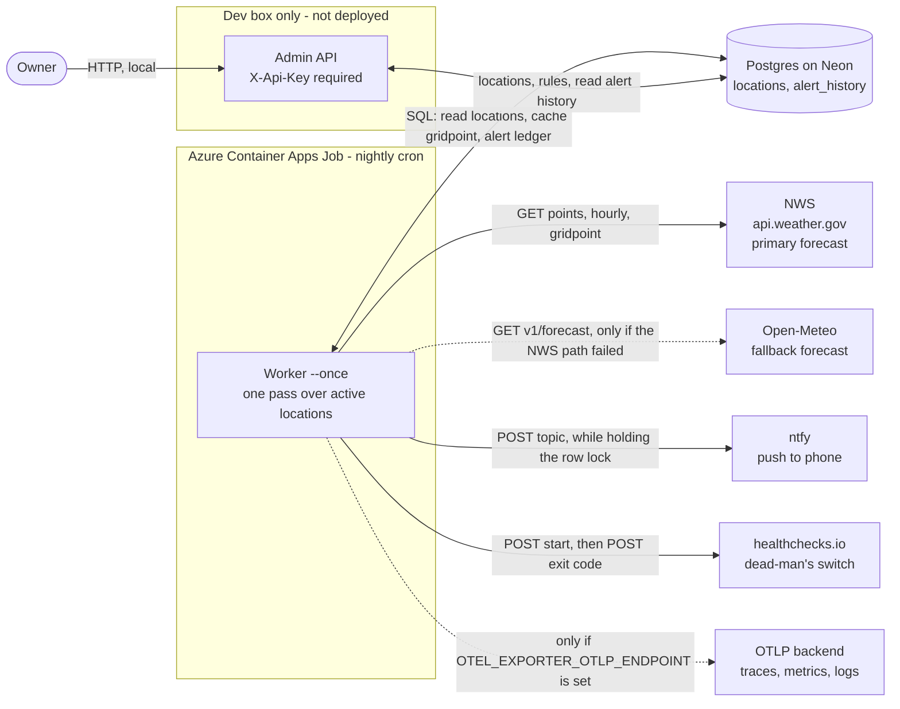
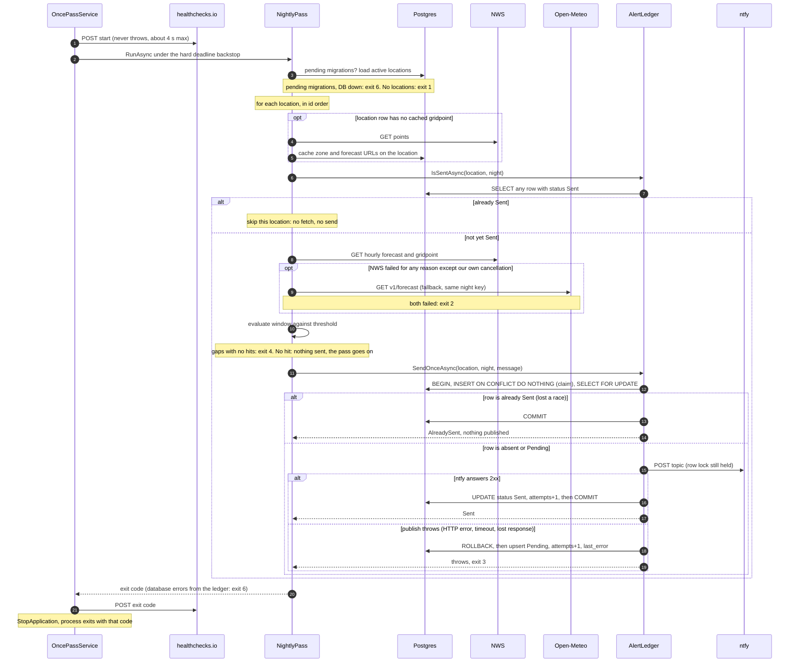
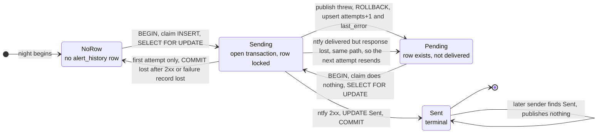

# PrecipitationNotification

[](https://github.com/HobbesMD/PrecipitationNotification/actions/workflows/ci.yml)

Every evening this checks the National Weather Service forecast for the coming night and pushes a notification to my phone if rain, snow or ice is due, with enough detail to know whether it's patio cushions or a shovel.

It's a .NET 10 worker that runs nightly as an Azure Container Apps Job, with Postgres for state. A merge to main tests, builds and deploys it. The interesting parts are the three problems below, and what I chose not to solve. Every decision is written down in the [decision log](docs/decisions.md).

## How this was built

Built with an AI pair (Claude Code); commits it wrote carry a `Co-Authored-By`
trailer. Design decisions are mine: each one is recorded in the
[decision log](docs/decisions.md#decision-log) with the alternative I rejected and the tests
that prove it.

## Why this is more than a script

### Time zones

The window is local: 8 PM to 7 AM at the location by default. NWS sends forecast hours as ISO-8601 with offsets. DST moves the clocks twice a year, so the fall-back night is 12 real hours and the spring-forward night is 10.

I convert the two local edges to instants once, then compare only instants ([D3](docs/decisions.md#d3-window-edges-are-utc-instants-dst-handled-at-the-edges-only)). An edge that DST skips moves forward by the gap. An edge that DST repeats takes whichever copy widens the window. The zone comes from the location, never the host ([D10](docs/decisions.md#d10-the-windows-time-zone-comes-from-the-location-not-from-config)). A timestamp with no offset is refused ([D14](docs/decisions.md#d14-review-strict-timestamps-and-a-validated-threshold)).

The proof is `Dst_transition_on_window_edge`, `Real_fall_back_fixture_has_exactly_twelve_hours_in_range_including_both_1am_hours` and `Synthetic_spring_forward_has_ten_hours_in_range_and_hits_match_planted_pops`. CI repeats the suite under three host time zones ([D17](docs/decisions.md#d17-ci-runs-the-tests-under-three-host-time-zones)). On the real fall-back night, production logged a 12-hour window ([D3](docs/decisions.md#d3-window-edges-are-utc-instants-dst-handled-at-the-edges-only)). Spring-forward hasn't happened in production yet.

### Idempotency

One night can see more than one run. Azure retries any failed run once ([D20](docs/decisions.md#d20-one-retry-and-the-duplicate-it-can-cause)), and I can start one by hand. The phone should still get one alert per location per night.

The key is `(location_id, night_date)`, and a unique index in Postgres enforces it ([D26](docs/decisions.md#d26-rules-and-coordinates-are-data-their-invariants-live-in-the-schema)). `night_date` is the local date the window starts, so a retry after midnight gets the same key ([D2](docs/decisions.md#d2-which-night-a-run-evaluates)). One transaction claims the row, locks it, publishes to ntfy and marks it `Sent`. A second sender waits, sees `Sent` and publishes nothing.

The send lives in ntfy, outside the transaction. If ntfy accepts a push but the response is lost, the row never reaches `Sent` and the next attempt sends again. I chose a possible duplicate over a possible missed alert ([D25](docs/decisions.md#d25-one-alert-per-location-per-night-a-locked-row-at-least-once)).

The proof, on real Postgres, is `Eight_simultaneous_senders_publish_exactly_once`, `Second_alert_for_the_same_location_and_night_violates_the_unique_index` and `Lost_response_is_resent_this_is_the_accepted_duplicate`. In a production test, one run sent and the next logged "already sent" ([D29](docs/decisions.md#d29-production-postgres-is-neons-free-tier-on-the-direct-endpoint)).

### Silence is ambiguous

No notification can mean a dry night, or that the job died three weeks ago. Nothing inside the job can tell those apart, because a job that never starts can't report anything.

So the watcher sits outside: a dead-man's switch on healthchecks.io ([D39](docs/decisions.md#d39-the-heartbeat-is-an-outside-watcher-healthchecksio-pinged-at-start-and-with-the-exit-code)). Each `--once` run pings at start, then pings its exit code. A non-zero code alerts at once. A run that never arrives or never finishes alerts after a one-hour grace period. Alerts go to email and a second ntfy topic. A failed ping never changes the run's exit code ([D40](docs/decisions.md#d40-a-heartbeat-or-telemetry-failure-never-changes-the-outcome-and-the-300-s-budget-holds-by-construction)). A forecast gap with no hits fails the run, so missing data is never called dry ([D16](docs/decisions.md#d16-review-round-2-a-gap-blocks-a-dry-verdict-not-an-alert)).

The proof is `Start_comes_before_the_pass_and_finish_after_it_with_the_passs_code` and `The_hard_deadline_finishes_with_7`. In a production drill I forced a deadline failure. The run and Azure's retry both exited 7, and the "down" alert reached my phone and my email ([D39](docs/decisions.md#d39-the-heartbeat-is-an-outside-watcher-healthchecksio-pinged-at-start-and-with-the-exit-code)).

## Architecture

For each active location in Postgres, the job fetches the NWS hourly forecast and raw gridpoint amounts, works out the next unfinished overnight window (8 PM to 7 AM by default) in the location's own time zone, and publishes one ntfy message if any hour in it is at or above the location's probability threshold. The message says rain, snow or ice, and how much.

### System context



The admin API isn't deployed. Locations and rules are database rows, and I manage them from my own machine ([D30](docs/decisions.md#d30-the-admin-api-is-local-only-behind-an-api-key)).

### One nightly pass



Evaluation is a pure function, so the DST tests need no network or database. The finish ping also covers a pass that failed or hit its deadline.

### The states of an alert row



The `status` column only stores `Pending` and `Sent`. "NoRow" and "Sending" aren't stored; they're on the diagram because the row behaves differently in each ([D55](docs/decisions.md#d55-three-mermaid-diagrams-each-traced-to-the-code)).

### Where things live

- `src/Worker`: the job. `Forecast/` holds the decision engine, `Pass/` the nightly loop and exit codes, `Alerts/` the idempotency ledger, `Nws/` and `OpenMeteo/` the providers, `Resilience/` the Polly pipelines.
- `src/Api`: the local admin API.
- `src/Persistence`: the EF Core model and migrations.
- `deploy/azure`: the deploy scripts and the [operations guide](deploy/azure/README.md).

## What I traded away

- **A possible duplicate alert.** Exactly-once isn't possible here, because the send lives in ntfy, outside the transaction. So I chose at-least-once. If a push may have gone out but the row never reached `Sent`, the next attempt sends again. That covers a lost ntfy response and a failed commit after a 2xx ([D25](docs/decisions.md#d25-one-alert-per-location-per-night-a-locked-row-at-least-once)), a commit that runs out of its time bound ([D44](docs/decisions.md#d44-review-the-ledgers-post-send-writes-had-no-bound-so-the-300-s-budget-was-arithmetic-again)), and the hard deadline cutting a send short ([D38](docs/decisions.md#d38-review-response-bodies-had-no-timeout-a-hard-backstop-a-breaker-for-the-gridpoint)). What I gained: a crash or lost request after the claim doesn't mean no alert that night, which it would under at-most-once ([D25](docs/decisions.md#d25-one-alert-per-location-per-night-a-locked-row-at-least-once)). On the nightly schedule, the next attempt is Azure's one retry ([D20](docs/decisions.md#d20-one-retry-and-the-duplicate-it-can-cause)). The next scheduled run is a different night, so if the retry also fails, that night gets no alert and the heartbeat fires ([D39](docs/decisions.md#d39-the-heartbeat-is-an-outside-watcher-healthchecksio-pinged-at-start-and-with-the-exit-code)).
- **A transaction held open across an HTTP call.** I gave up short transactions. The row lock stays held while ntfy answers, for up to 30 s. An `idle_in_transaction_session_timeout` under 30 s would kill the transaction and fail the run. What I gained: no second sender can publish until the first one finishes ([D25](docs/decisions.md#d25-one-alert-per-location-per-night-a-locked-row-at-least-once)).
- **A deploy identity that can reach the secrets indirectly.** The deploy role can't list secret values, but it can deploy any image, and that image runs with every secret mounted. So the role only narrows what an abused token can do. The boundary is the federated subject: only a job in the main-only `production` environment can sign in ([D53](docs/decisions.md#d53-review-the-guard-passed-a-schema-change-from-a-subdirectory-the-deploy-role-could-read-the-secrets)). What I gained: CI signs in with no stored credential ([D48](docs/decisions.md#d48-ci-signs-in-to-azure-with-oidc-no-stored-credential-one-environment-one-resource)), and the app's secrets never enter GitHub ([D49](docs/decisions.md#d49-ci-deploys-the-image-and-nothing-else-the-apps-secrets-never-enter-github)).
- **A human step on every schema change.** A merge that changes a migration doesn't deploy until I've run `Worker --migrate` and re-run the deploy by dispatch. A rollback across a migration stops the same way. I gave up fully automatic deploys for that case. What I gained: GitHub never holds a connection string with DDL rights, and no schema change runs unattended ([D28](docs/decisions.md#d28-migrations-are-explicit-a-run-refuses-an-out-of-date-schema), [D51](docs/decisions.md#d51-the-migration-guard-a-deploy-stops-if-the-schema-changed-until-ive-migrated)).
- **A hand-built spring-forward payload.** The spring-forward forecast test runs on a hand-built payload, not a real NWS capture. So that night isn't proven against real NWS data. What I gained: the test exists now, while the real night is months away. A real capture replaces it around 2027-03-08 ([D9](docs/decisions.md#d9-probability-decides-whether-to-alert-amounts-decide-how-loudly), [ledger](docs/decisions.md#debt-ledger)).
- **No wet capture for the fallback.** The real Open-Meteo captures hold no precipitation, so wet-night mapping is proven only with hand-built payloads ([D35](docs/decisions.md#d35-open-meteo-maps-onto-the-same-types-and-its-hours-end-at-their-timestamp)). The fallback was drilled locally, not in production, because a production drill would mean editing the job's config ([D38](docs/decisions.md#d38-review-response-bodies-had-no-timeout-a-hard-backstop-a-breaker-for-the-gridpoint)). What I gained: a fallback in place now, and the capture can come when a wet spell does ([D36](docs/decisions.md#d36-open-meteo-is-the-fallback-a-fallback-night-keeps-the-same-key-and-says-where-it-came-from)).
- **An admin API that runs only on my dev box.** Adding a location or changing a threshold needs my machine and the database connection string. What I gained: no public endpoint guarding a write-capable key and the database credentials, and no ingress, auth or running cost for it. A second person managing locations, or a UI, would change this ([D30](docs/decisions.md#d30-the-admin-api-is-local-only-behind-an-api-key)).
- **One ntfy topic for every location.** All locations publish to the same topic, so I can't route one location's alerts elsewhere. Per-location topics would mean storing a publish-capable secret in the database. What I gained: the topic stays a job secret ([D21](docs/decisions.md#d21-secrets-live-in-the-job-not-in-the-image-the-repo-or-the-logs), [ledger](docs/decisions.md#debt-ledger)).
- **Resilience tests that can time out on a cold build.** `NtfyResilienceTests` and `NwsBreakerIsolationTests` occasionally time out on a cold first build. It reproduced on `main` before Block 6 touched anything, and the fix is unscheduled ([ledger](docs/decisions.md#debt-ledger)). I gave up a first build that always passes. What I gained: these tests run over real HTTP against WireMock, not against fakes ([D34](docs/decisions.md#d34-ntfy-is-retried-only-when-the-request-provably-never-arrived), [D38](docs/decisions.md#d38-review-response-bodies-had-no-timeout-a-hard-backstop-a-breaker-for-the-gridpoint)).

## What I'd change at scale

None of this is built. It's where the current design stops, and what I'd do about it ([D56](docs/decisions.md#d56-the-readme-says-what-id-change-at-scale-and-only-what-i-chose-to-defend)).

**With real users:**

- **Name the place, and give each subscriber their own topic.** Alerts don't say where they're for, and everyone on a topic reads everything on it. A second subscriber would read my alerts and couldn't tell whose they were. I'd add the name, then move to access-controlled topics per user. That means self-hosting ntfy.
- **Run hourly instead of once.** One 23:00 UTC run only suits one part of the map. Further away the alert arrives late or hours early, and nothing reports an error. I'd run hourly and pick the locations whose night starts soon. The idempotency key already makes extra runs safe. "Is this location due?" is new time-zone logic that needs its own DST tests.
- **Record a verdict per location per night.** Silence is solved per job, not per location: a dry night leaves no row, and one permanently bad location would turn the heartbeat red every night. A watcher that's always red is as useless as silence. I'd write one outcome per location per night and alert on coverage. The cost is that a run can then exit 0 with failed locations.

**With 10,000 locations:**

- **Replace the sequential loop with a work table.** The pass handles locations one at a time against a 100 s deadline. At an estimated 1 to 2 s each, not yet measured, that reaches 50 to 100 locations. Azure's retry would start again from the same low ids, so later locations would never be evaluated. I'd add a per-night work table that replicas claim with `FOR UPDATE SKIP LOCKED`, so a retry resumes where the last run stopped.
- **Put a rate limiter ahead of the send.** ntfy's documented defaults allow about 80 publishes in a 100 s pass, and a storm alerts everyone at once, so the limit bites on the worst nights. I'd add a token bucket before the send, outside the row lock, and pay for or host ntfy.

**What wouldn't change:** the `(location_id, night_date)` key enforced in the database, at-least-once delivery, and a watcher outside the job.

## Running

```
cp .env.example .env   # then fill in real values
docker compose up -d                                     # local Postgres 17
dotnet run --project src/Worker -- --migrate             # apply EF migrations (never automatic)
dotnet run --project src/Api                             # admin API: POST /locations (X-Api-Key)
dotnet run --project src/Worker -- --once                # one pass over every active location
dotnet run --project src/Worker -- --once --dry-run      # print the message, don't send or record it
dotnet run --project src/Worker                          # long-running: a pass now, then every Worker__Interval
dotnet test                                              # DB tests need Docker (Testcontainers)

docker compose up -d aspire-dashboard                    # local traces/metrics/logs UI: http://localhost:18888
OTEL_EXPORTER_OTLP_ENDPOINT=http://localhost:4317 dotnet run --project src/Worker -- --once --dry-run

docker build -t precip .
docker run --rm precip --self-check                # image has real time-zone data? (exit 0/5)
docker run --rm --env-file .env precip --once --dry-run   # full pipeline in a UTC container
                                                          # (ConnectionStrings__Precip must reach the DB
                                                          #  from inside the container, e.g. host.docker.internal)
```

Deployed as an Azure Container Apps Job on a nightly cron: see
[deploy/azure/README.md](deploy/azure/README.md).

## Decision log

[docs/decisions.md](docs/decisions.md) holds the debt ledger and 57 decisions, each with the alternative I rejected, why, what would break it, and the tests that prove it. Each block's work had an independent review, and its findings are in the log too.

| Block | What it added | Entries |
|---|---|---|
| 2 | Decision engine: overnight window, DST, amounts | D1–D16 |
| 3 | Container, nightly cron, secrets | D17–D24 |
| 4 | Postgres, idempotency, admin API | D25–D32 |
| 5 | Polly resilience, Open-Meteo fallback | D33–D38 |
| 6 | Heartbeat, OpenTelemetry | D39–D47 |
| 7 | CI/CD: OIDC, migration guard, supply chain | D48–D53 |
| 8 | This design doc, and corrections to the log | D54–D57 |
